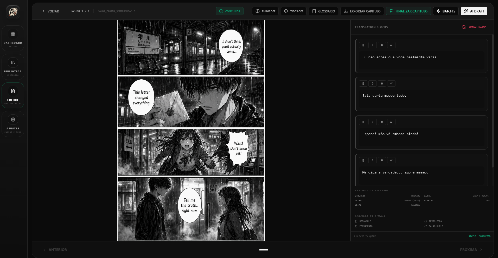
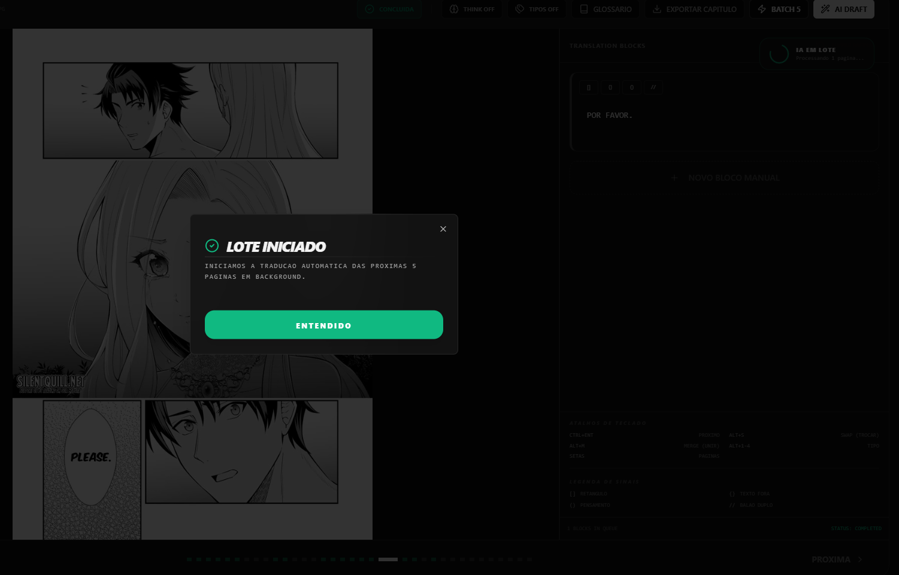
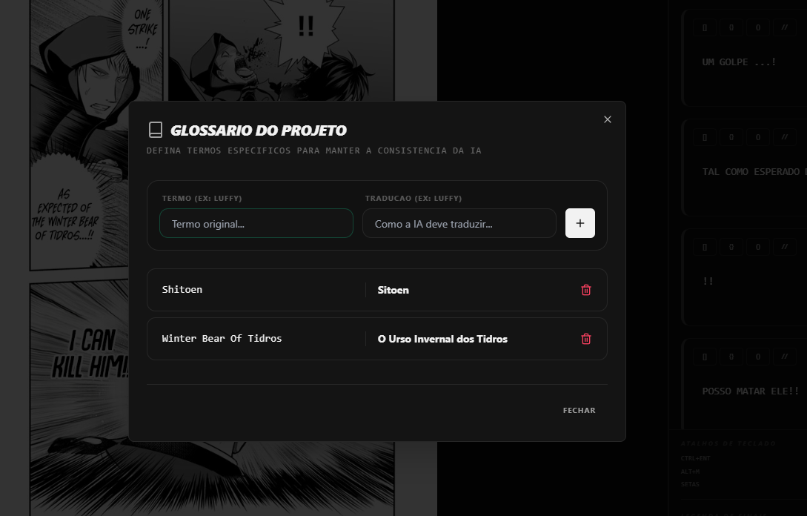
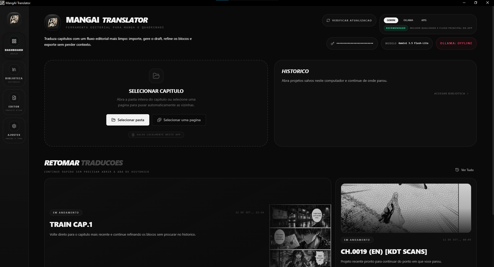
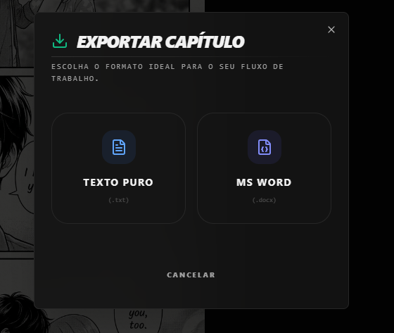
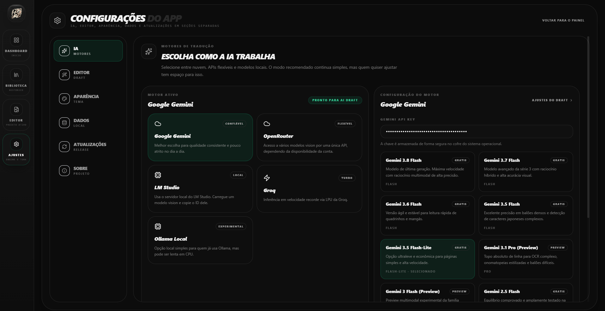

# MangAI Translator


Desktop app para localização assistida de mangá e quadrinhos. Conheça a demonstração visual e recursos no [Website Oficial](https://zentsy.github.io/MangAItranslator/).

<p>
  <a href="https://zentsy.github.io/MangAItranslator/">
    
  </a>
  <a href="https://github.com/Zentsy/MangAItranslator/releases/latest">
    
  </a>
  <a href="https://github.com/Zentsy/MangAItranslator/releases/tag/v0.4.0">
    
  </a>
  <a href="https://ko-fi.com/zentsy">
    
  </a>
  <a href="LICENSE">
    
  </a>
</p>

O MangAI Translator ajuda você a importar um capítulo, gerar um rascunho com IA, revisar bloco por bloco e exportar o texto final sem perder o contexto da página.

> A IA traduz **com** você, não **por** você. Modelos podem errar, transcrever em vez de traduzir ou interpretar balões fora de ordem. Revise sempre antes de publicar qualquer tradução.

## 🌐 Website & Download

- **Site Oficial**: [zentsy.github.io/MangAItranslator](https://zentsy.github.io/MangAItranslator/) — Apresentação visual detalhada, fluxo de trabalho, galeria e download rápido.
- **Baixar a versão mais recente**: [GitHub Releases (Instalador Windows x64)](https://github.com/Zentsy/MangAItranslator/releases/latest)
- **Release atual**: [v0.4.0](https://github.com/Zentsy/MangAItranslator/releases/tag/v0.4.0)

Se o projeto te ajudar e você quiser apoiar o desenvolvimento contínuo, você pode contribuir no [Ko-fi](https://ko-fi.com/zentsy).

## Aviso para Windows SmartScreen

Como o app ainda é novo e não tem code signing de distribuição no Windows, o SmartScreen pode mostrar um aviso de "aplicativo não reconhecido" na instalação.

Isso não significa que o app tenha sido detectado como malware. Hoje o que acontece é:

- o instalador ainda não tem reputação consolidada no ecossistema da Microsoft
- o app usa assinatura do updater para validar atualizações, mas isso é diferente de code signing do Windows
- a meta é reduzir esse atrito nas próximas versões com code signing de distribuição

Se você baixou o app deste repositório oficial e quiser testar mesmo assim, revise o aviso do Windows com calma antes de continuar.

## O que o app faz

- **Design System Nanquim & Washi**: interface rica e densa inspirada na arte tradicional de mangá com suporte a Dark Nanquim e Paper Light artesanal.
- **Perfis de Tradução & Presets de Idioma**: configurações direcionadas para Mangá (JP), Manhwa (KR), Manhua (CN) e Comics ocidentais, com ajuste de persona e tom de voz.
- **Preset Especializado Japonês Raw $\rightarrow$ PT-BR**: prompt avançado para contornar kanjis homófonos, leitura vertical (*tategaki*) e sutilezas de furiganas.
- **Segunda Passada de Naturalidade (PT-BR)**: polimento inteligente de fluidez em diálogos preservando contexto dramático e pontuação de quadrinhos.
- **Iconografia Autoral Vetorial**: substituição integral de ícones genéricos por ilustrações SVG puras de Pena G, tinteiros e balões de mangá (adeus AI slop).
- **Tradução em Lote (Batch Queue)**: fila de processamento sequencial de múltiplas páginas com monitor de progresso em tempo real no cabeçalho do editor.
- **Glossário Local por Projeto**: termos, nomes próprios e golpes persistidos em banco SQLite local e injetados diretamente nos prompts.
- **Memória de Curto Prazo**: contexto transmitido entre páginas consecutivas para manter consistência narrativa e de pronomes.
- **Atalhos Rápidos de Produtividade**: tecla `M` para mesclar balões adjacentes, `S` para trocar ordem de leitura e navegação por teclado.
- **Cofre Seguro de Chaves (Keyring)**: isolamento de chaves de API com proteção criptográfica nativa do sistema operacional.
- **Multi-Provedores de IA**: suporte nativo a Google Gemini, OpenRouter (Auto-Free inteligente), Groq Cloud e modelos locais via LM Studio e Ollama.
- **Exportação Estruturada**: saída editorial limpa em formatos `.txt` e `.docx`.
- **Auto-Updater Embutido**: checagem, download e atualização com validação criptográfica pelo próprio app.

## Motores de IA

### Recomendado

- `Gemini`: melhor experiência geral para qualidade, OCR e consistência (Gemini 3.8 Flash nativo).
- `Groq`: modo turbo para páginas leves com velocidade quase instantânea no hardware LPU.
- `OpenRouter Auto grátis`: seleciona automaticamente modelos vision gratuitos com rotação de chaves e fallback seguro.

### Local

- `LM Studio`: melhor opção local hoje. Suporta aceleração por GPU e modelos vision modernos como Qwen 3 VL.
- `Ollama`: opção local simples e experimental para quem já usa o ecossistema Ollama.

### Importante sobre modelos grátis

No OpenRouter, a qualidade depende do modelo gratuito disponível no momento. O app tenta corrigir respostas duplicadas, vazias ou mal formatadas, filtra automaticamente blocos internos de raciocínio (`<think>`) e tem fallback inteligente, mas alguns modelos pequenos podem apenas transcrever o texto em vez de traduzir.

## ✒️ Novidades da Versão 0.4.0

- **Nova Identidade Visual "Paper Light"**: modo claro reconstruído do zero com papéis Washi cru, contrastes em nanquim e selos Hanko (認, 済, 動, 筆).
- **Segunda Passada de Naturalidade**: revisão opcional pós-tradução para refinar a fluidez dos diálogos em português brasileiro sem perder o contexto dramático.
- **Preset Especializado Japonês Raw $\rightarrow$ PT-BR**: engenharia de prompt para desambiguação de kanjis homófonos, furigana e leitura tategaki.
- **Iconografia Autoral & Adeus AI Slop**: novo conjunto de ícones vetoriais em SVG puro (Penas G, tinteiros, balões de fala, grito e pensamento) e nova Logo Oficial em SVG puro com redução de ~1.8MB no instalador.
- **Otimização do OpenRouter Auto-Free**: teto estendido de tokens (4096) e supressão de tokens de raciocínio para evitar estouro de limite nos modelos gratuitos.

<details>
<summary><b>Histórico de Versões Anteriores (v0.3.x e anteriores)</b></summary>

### v0.3.5
- Injeção do changelog real na tela de atualização (UpdateModal) com suporte a Markdown.
- Geração automatizada de notas de lançamento na esteira de CI do GitHub Actions.

### v0.3.1
- Correção de erro na exportação Word (.docx) em ambientes WebView2 via ArrayBuffer binário nativo.

### v0.3.0
- Nova identidade visual artesanal inspirada em Nanquim & Pena G.
- Fila de tradução em lote sequencial com monitor de progresso em tempo real.
- Glossário persistente por projeto com SQLite local.
- Memória de curto prazo entre páginas consecutivas.
- Atalhos de alta velocidade no editor (`M` e `S`).
- Cofre seguro de credenciais com isolamento no keyring do SO.

### v0.2.0
- Multi-provedores: OpenRouter, LM Studio local, Groq e Google Gemini.
- Tipagem semântica de balões: [RET], {FORA}, (PEN) e //DBL//.
</details>

## Capturas de tela

### Destaque

O editor é o coração do app, agora com monitor de tradução em lote em tempo real, integração direta de glossário, perfis de tradução e atalhos rápidos de revisão (`M`, `S`).



### Fluxo de Trabalho & Produtividade

| Tradução em Lote (Batch) | Glossário por Projeto |
| --- | --- |
|  |  |
| Enfileire múltiplas páginas e acompanhe o progresso em tempo real enquanto revisa. | Defina termos, nomes e golpes persistidos em SQLite injetados nos prompts. |

| Dashboard e Projetos | Exportação Editorial |
| --- | --- |
|  |  |
| Importe capítulos, acompanhe projetos recentes e volte rápido para o que estava traduzindo. | Exporte o capítulo final em `.txt` ou `.docx` sem sair do fluxo. |

### Configurações e tema

| Modelos e Motores | Tema Paper Light |
| --- | --- |
|  |  |
| Gemini 3.8 Flash, Claude Sonnet 5, GPT-6 Astra, Groq LPU e modelos locais. | Interface editorial inspirada em papel Washi cru e Nanquim tradicional. |

## Fluxo rápido

1. Escolha o motor de IA e o perfil de tradução desejado.
2. Importe um capítulo ou conjunto de páginas.
3. Gere o `AI Draft` (individual ou em lote).
4. Revise os blocos no editor com atalhos (`M`, `S`).
5. (Opcional) Aplique a `Segunda Passada` para polimento de linguagem natural.
6. Exporte em `.txt` ou `.docx`.

## Roadmap

### Próximo Ciclo: Fase v0.5.0 (Colaboração & Typesetting Assistido)

- **Typesetter Helper Visual**: renderização prévia do texto traduzido diretamente dentro dos balões na imagem com tipografias clássicas de mangá.
- **Dicionário de Onomatopeias (SFX)**: catálogo integrado de efeitos sonoros japoneses (擬音語・擬態語) com sugestões de adaptação para quadrinhos.
- **Pacote de Projeto .mangai**: compartilhamento fácil de projetos completos (imagens, cache, SQLite e histórico) entre equipes de scanlation.
- **Detecção Local de Coordenadas de Balões (WASM)**: pré-detecção de bounding boxes de balões no cliente via WebAssembly para ordenação visual imediata.

### Futuro (v1.0.0)

- Code signing de distribuição no Windows para eliminar por completo os avisos do SmartScreen.
- Leitura de mangás direto da fonte via extensões independentes (estilo Mihon).
- Suporte a múltiplos idiomas de saída (JP, KO, ZH direto para EN e ES).
- Distribuição multiplataforma oficial (Linux e macOS).

## Desenvolvimento

### Requisitos

- `Node.js` (LTS)
- `Rust` (Stable)
- Dependências de compilação do Tauri instaladas no sistema

### Rodando em desenvolvimento

```bash
npm install
npm run tauri -- dev
```

### Lint

```bash
npm run lint
```

### Build do App Desktop

```bash
npm run build
cd src-tauri
cargo check
```

### Landing Page Oficial (site/)

A landing page pública do projeto é construída com React 19, Vite e Tailwind CSS v4 na pasta `site/create-mangaitranslator-landing-page`:

```bash
cd site/create-mangaitranslator-landing-page
npm install
npm run dev
```

O deploy para produção gera um bundle standalone unificado (`site/index.html`) publicado no GitHub Pages via branch `gh-pages`.

## Status do projeto

O app está funcional e pronto para uso real no Windows. Com a entrega da **v0.4.0**, a interface atinge sua maturidade visual Nanquim & Washi e ganha recursos profissionais de controle editorial e refinamento de linguagem.

## Uso responsável

Use o app apenas em materiais próprios, licenciados ou para os quais você tenha permissão de localização ou tradução.

## Licença

Este projeto está licenciado sob a licença MIT. Veja [LICENSE](LICENSE).
